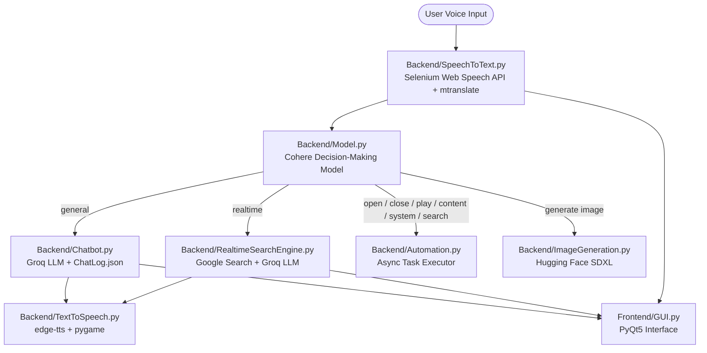

# NOVA — Notable Organizer and Versatile Assistant

**NOVA** is a voice-enabled, multi-modal AI desktop assistant built with Python and PyQt5. It combines an intelligent intent-routing model with conversational AI, real-time web search, desktop and browser automation, AI image generation, speech recognition with automatic translation, and neural text-to-speech.

---

## Key Features

- **Intent Classification & Multi-Task Routing (`Backend/Model.py`)**
  Uses Cohere (`command-r-plus`) as a First-Layer Decision-Making Model (DMM) to classify natural-language queries into `general`, `realtime`, `open`, `close`, `play`, `generate image`, `system`, `content`, `google search`, `youtube search`, `reminder`, or `exit`—including compound multi-task commands.
- **Conversational AI (`Backend/Chatbot.py`)**
  Powered by Groq (`llama3-70b-8192`) with real-time date/time awareness and persistent conversation history stored in `Data/ChatLog.json`.
- **Real-Time Web Search (`Backend/RealtimeSearchEngine.py`)**
  Fetches live Google search results (`googlesearch-python`) and synthesizes up-to-date, professional responses using Groq's LLM.
- **Desktop & Browser Automation (`Backend/Automation.py`)**
  Executes tasks concurrently via `asyncio`:
  - Open and close Windows applications (`AppOpener`) with automatic website fallback.
  - Play videos directly on YouTube or open YouTube/Google searches (`pywhatkit`, `webbrowser`).
  - Generate written content (emails, essays, code, letters) with Groq (`mixtral-8x7b-32768`), save to `Data/`, and open it in Notepad.
  - Control system volume (`mute`, `unmute`, `volume up`, `volume down` via `keyboard`).
- **AI Image Generation (`Backend/ImageGeneration.py`)**
  Generates 4 high-resolution image variations asynchronously using Hugging Face's Stable Diffusion XL (`stabilityai/stable-diffusion-xl-base-1.0`) and opens them automatically with Pillow.
- **Speech-to-Text & Auto-Translation (`Backend/SpeechToText.py`)**
  Uses headless Chrome (Selenium) with the Web Speech API for voice recognition, `langdetect` for language detection, and `mtranslate` to translate non-English speech to English.
- **Neural Text-to-Speech (`Backend/TextToSpeech.py`)**
  Synthesizes natural voice responses via Microsoft Edge TTS (`edge-tts`) and plays them with `pygame`. Long responses are smartly summarized aloud while the full text is displayed on screen.
- **Custom Desktop GUI (`Frontend/GUI.py`)**
  Frameless dark-mode PyQt5 interface with a Home view (animated NOVA orb + mic toggle + live status indicator) and a Chat view displaying conversation logs.
- **Book Finder Utilities (`Backend/books_finder.py`, `Backend/book_mover.py`)**
  Standalone helper scripts to search, download, and organize PDF books.

---

## Architecture



`main.py` orchestrates two threads:
1. **Background Assistant Thread** — polls microphone status, captures speech, routes intents through `FirstLayerDMM`, executes tasks, and speaks responses.
2. **Main GUI Thread** — runs the PyQt5 application, syncing state with the backend through files in `Frontend/Files/`.

---

## Project Structure

```text
AIA - NOVA/
├── main.py                        # Main entry point (threading + pipeline orchestration)
├── Requirements.txt               # Python dependencies
├── .env.example                   # Environment variable template
├── Backend/
│   ├── Model.py                   # First-layer decision-making / intent classifier (Cohere)
│   ├── Chatbot.py                 # General conversational AI (Groq)
│   ├── RealtimeSearchEngine.py    # Live Google search + LLM synthesis (Groq)
│   ├── Automation.py              # App, browser, volume, and AI content automation
│   ├── ImageGeneration.py         # Async Stable Diffusion XL image generator (Hugging Face)
│   ├── SpeechToText.py            # Web Speech API recognition + auto-translation
│   ├── TextToSpeech.py            # Neural TTS playback (edge-tts + pygame)
│   ├── books_finder.py            # Standalone PDF book search & downloader
│   └── book_mover.py              # Helper to monitor and move downloaded PDFs
├── Frontend/
│   ├── GUI.py                     # PyQt5 desktop interface (Home & Chat screens)
│   ├── Files/                     # Runtime IPC state files (Mic, Status, Responses, Database, ImageGeneration)
│   └── Graphics/                  # UI icons and animated NOVA orb GIFs
└── Data/
    └── ChatLog.json               # Persistent chat history (generated audio/images stored here at runtime)
```

---

## Prerequisites

- **OS:** Windows 10 / 11 (required for `AppOpener`, Notepad integration, and Windows media key automation)
- **Python:** 3.10 or 3.11
- **Google Chrome:** Installed locally (used in headless mode by Selenium for Speech-to-Text; `webdriver-manager` downloads ChromeDriver automatically if `C:/Windows/chromedriver.exe` is not present)
- **API Keys:**
  - [Cohere API Key](https://dashboard.cohere.com/)
  - [Groq API Key](https://console.groq.com/)
  - [Hugging Face API Token](https://huggingface.co/settings/tokens)

---

## Installation & Setup

1. **Clone the repository**
   ```bash
   git clone https://github.com/ArnavAV01/AIA-Nova.git
   cd AIA-Nova
   ```

2. **Create and activate a virtual environment**
   ```bash
   python -m venv venv
   venv\Scripts\activate
   ```

3. **Install dependencies**
   ```bash
   pip install -r Requirements.txt
   pip install langdetect
   ```
   > **Note:** `langdetect` is used in `Backend/SpeechToText.py` for automatic language detection.

4. **Configure environment variables**
   Copy `.env.example` to `.env` in the project root and fill in your credentials:
   ```env
   CohereAPIKey=your_cohere_api_key
   GroqAPIKey=your_groq_api_key
   HuggingFaceAPIKey=your_huggingface_api_key
   Username=YourName
   Assistantname=NOVA
   InputLanguage=en
   AssistantVoice=en-CA-LiamNeural
   ```

   | Variable | Description | Example |
   | :--- | :--- | :--- |
   | `CohereAPIKey` | API key for Cohere intent classification | `cohere_...` |
   | `GroqAPIKey` | API key for Groq LLM chat, search, and content writing | `gsk_...` |
   | `HuggingFaceAPIKey` | Access token for Hugging Face Inference API (SDXL) | `hf_...` |
   | `Username` | Your name, used in prompts and chat display | `Arnav` |
   | `Assistantname` | Display name of the assistant | `NOVA` |
   | `InputLanguage` | BCP-47 language code for Web Speech recognition | `en`, `hi-IN` |
   | `AssistantVoice` | Microsoft Edge TTS neural voice name | `en-CA-LiamNeural`, `en-US-AriaNeural` |

---

## Usage

Run the assistant from the project root directory:

```bash
python main.py
```

1. The PyQt5 desktop window opens on the **Home** screen with the animated NOVA orb.
2. Click the **Microphone** icon to toggle voice listening on/off.
3. Switch to the **Chat** tab in the top bar to view the full conversation transcript.

### Example Voice Commands

- **General Q&A:** *"What is quantum computing?"* / *"What does your name stand for?"*
- **Real-Time Info:** *"Who is the current Prime Minister of India?"* / *"What's today's top tech news?"*
- **App & Web Automation:** *"Open Chrome and Spotify"* / *"Close Notepad"* / *"Play Believer on YouTube"*
- **Content Generation:** *"Write an application for sick leave"* (saves to `Data/` and opens in Notepad)
- **System Controls:** *"Volume up"* / *"Mute"*
- **Image Generation:** *"Generate an image of Mount Everest at sunset"*
- **Exit:** *"Bye NOVA"*

---

## Notes & Troubleshooting

- **Model Updates:** Cloud providers occasionally deprecate older model IDs (such as `llama3-70b-8192`, `mixtral-8x7b-32768`, or `command-r-plus`). If you receive a model deprecation error from Groq or Cohere, update the `model=` string in `Backend/Chatbot.py`, `Backend/RealtimeSearchEngine.py`, `Backend/Automation.py`, or `Backend/Model.py` to a currently supported model.
- **Microphone Access:** `Backend/SpeechToText.py` launches headless Chrome with media stream flags; ensure Windows microphone permissions are enabled for Chrome/Python.
- **Standalone Testing:** Each backend module (`Model.py`, `Chatbot.py`, `RealtimeSearchEngine.py`, `SpeechToText.py`, `TextToSpeech.py`) includes an `if __name__ == '__main__':` block so you can test individual components directly from the terminal.
